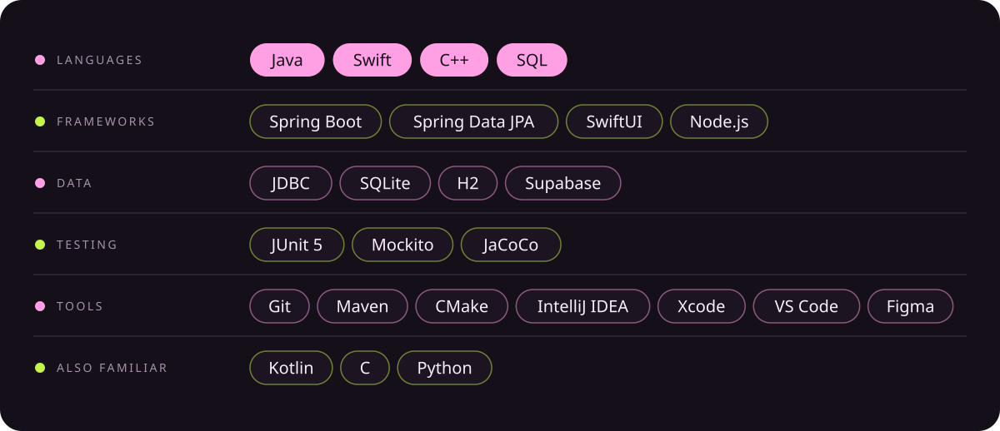
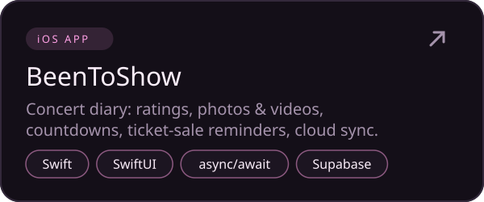
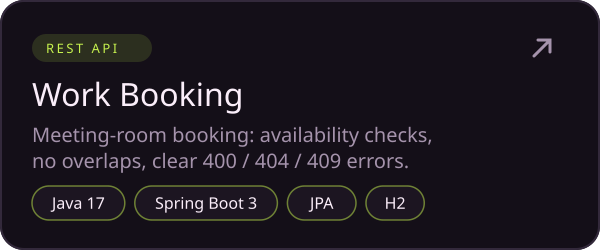
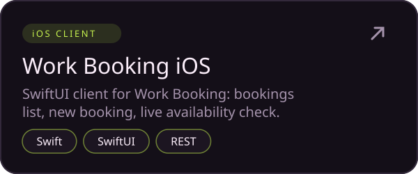
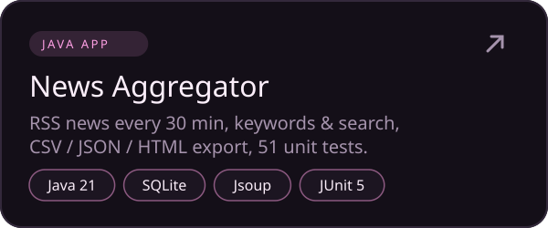
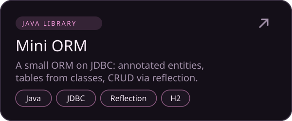
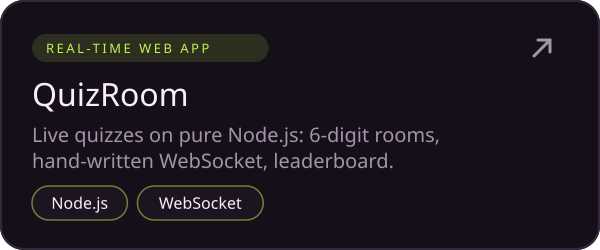

 

- 🎓 2nd year at **HSE University**, Faculty of Computer Science
- 🎯 Heading for **backend** (Java, Spring Boot) or **iOS** (Swift, SwiftUI)
- 🧩 Algorithms and math are my kind of puzzles

  
  
  
  
  
  

More projects: <a href="https://github.com/wmeenw/benchmark-c-plus-plus">STL benchmark (C++)</a> · <a href="https://github.com/wmeenw/log-c-plus-plus">Logger (C++)</a> · <a href="https://github.com/wmeenw/fractal-flame">Fractal Flame</a> · <a href="https://github.com/wmeenw/spacex-api-client">SpaceX API client</a> · <a href="https://github.com/wmeenw/log-analyzer">Log analyzer</a> · <a href="https://github.com/wmeenw/csv-annotation-parser">CSV parser</a> · <a href="https://github.com/wmeenw/word-game">Word Game</a>

  
  

  
  
  

